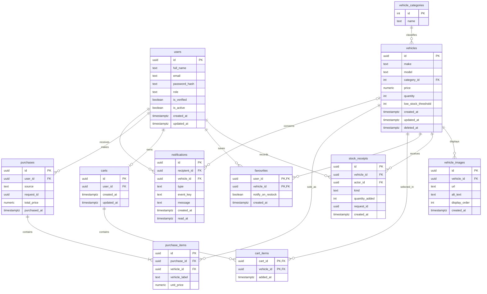

# Car Dealership Inventory System

Planning and database design for the Incubyte full-stack kata. The intended product is a shared, login-protected vehicle catalogue: users browse, search, save, and buy stock; admins maintain listings and inventory. A minimal TypeScript/Express backend now exposes `GET /health`; the application schema and product endpoints are not implemented yet.

## Product and assignment scope

A `vehicles` row is a stock line for interchangeable units of one make and model/variant, not a physical car identified by VIN. Its `quantity` is shared across every user. A purchase records a sale and reduces that quantity by one; it does not collect payment. Zero-stock active listings remain visible so the required Purchase button can be shown disabled. Soft-deleted listings are excluded from normal browsing.

| Source | Functionality |
|---|---|
| Incubyte requirements | Registration and login with token authentication; persistent database; protected vehicle listing, search, add and update; admin deletion and restock; direct one-unit purchase; React SPA using HTML5, CSS3 and Tailwind; disabled Purchase button at zero stock; TDD, tests, README, AI disclosure and `PROMPTS.md`. |
| Chosen extensions | Ordered vehicle images; favourites and opt-in restock alerts; reusable cart with atomic checkout; purchase and stock-receipt history; targeted in-app notifications. |

The cart supplements the required `POST /api/vehicles/:id/purchase` direct-purchase endpoint. It gathers one unit of each selected vehicle, without reserving stock, and buys them together only at checkout. There is no payment processing, rental booking, financing, supplier management, multi-branch stock, reservation, return/refund flow, or VIN-level tracking.

The brief describes vehicle operations as protected, explicitly limits deletion and restock to admins, and shows admin-only listing controls in the frontend. **Project interpretation:** authenticated `user` and `admin` roles may browse, search, purchase, and manage their own cart, favourites, and notifications; only `admin` may create, edit, soft-delete, or restock listings and manage images. Registration always creates a `user`; client input cannot assign `admin`. Every permission must be enforced by the server, as well as reflected in the UI.

| Method and exact required route | Access | Effect |
|---|---|---|
| `POST /api/auth/register` | Public | Register a normal user |
| `POST /api/auth/login` | Public | Return an authentication token |
| `POST /api/vehicles` | Admin | Create listing and opening-stock receipt when quantity is positive |
| `GET /api/vehicles` | Authenticated | List active listings, including zero stock |
| `GET /api/vehicles/search` | Authenticated | Filter by make, model, category, and price range |
| `PUT /api/vehicles/:id` | Admin | Edit catalogue details, never quantity directly |
| `DELETE /api/vehicles/:id` | Admin | Soft-delete listing |
| `POST /api/vehicles/:id/purchase` | Authenticated | Buy one unit immediately |
| `POST /api/vehicles/:id/restock` | Admin | Add positive stock and record receipt |

The selected backend stack is Node.js/TypeScript with Express and `pg`, **PostgreSQL** for persistence, and React with HTML5, CSS3, and Tailwind CSS for the planned SPA. The implementation should keep routes/controllers, business logic, and database access separate.

## Database overview

The eleven-table design and column-by-column data dictionary are in [Database design](docs/database-design.md).

| Table | Purpose | Key relationships |
|---|---|---|
| `users` | Credentials, role, account flags | Parent of purchases, receipts, favourites, carts, notifications |
| `vehicle_categories` | Normalised body styles | One category classifies many vehicles |
| `vehicles` | Catalogue and current shared quantity | One vehicle has images, receipts, cart links, favourites, sale items, notifications |
| `vehicle_images` | Ordered image references and alt text | Many per vehicle |
| `stock_receipts` | Opening and restock additions | Many per vehicle and actor |
| `favourites` | Saved vehicles and alert preference | User–vehicle many-to-many bridge |
| `carts` | One reusable cart per user | Zero or one per user |
| `cart_items` | One selected unit per vehicle | Cart–vehicle many-to-many bridge |
| `purchases` | Completed direct sale or checkout header | Many per user; each has one or more items |
| `purchase_items` | Immutable sold-unit label and price | Purchase–vehicle historical bridge |
| `notifications` | In-app messages for explicit recipients | Many per user; optionally linked to a vehicle |

### Entity relationships



The three bridge tables are `favourites` (saved user–vehicle links), `cart_items` (selected cart–vehicle links), and `purchase_items` (historical purchase–vehicle links). `users` to `carts` is at most one cart per user. A completed purchase must have at least one item; application transaction logic enforces that cross-row invariant. The optional vehicle end of `notifications` means a notification may have no related vehicle.

## Integrity and workflows

PostgreSQL will enforce primary/foreign keys; case-insensitive unique email and category names; one active `(make, model)` stock line; nonblank labels; nonnegative prices, stock, and thresholds; positive receipts; unique image positions; unique favourite/cart pairs; one cart per user; and unique request/event keys. The identity rule may need to include year or trim if those become separate stock lines. Indexes serve active category/price search, vehicle sales history, ordered images, and recipient inbox lookup. [Database design](docs/database-design.md#indexes-and-constraints) lists every planned index and its reason.

Physical deletion is restricted for users, vehicles, categories, purchases, receipts, and sale items where it would destroy history. Vehicle deletion sets `deleted_at`; old purchase snapshots remain readable. Cart, favourite, and image data are removed only through explicit user/admin actions in this version. Images are URL/reference rows, not raw binary columns; the lowest `display_order` is the cover.

| Workflow | Transaction rule |
|---|---|
| Create listing | Admin creates vehicle at quantity zero; if opening quantity is positive, insert one `opening` receipt and set quantity in the same transaction. |
| Direct purchase | Reuse an earlier result for the same user/request key; otherwise lock an active vehicle with stock, record header and one label/price snapshot, decrement one, create threshold alerts, and commit together. |
| Restock | Admin supplies a positive increment and request key; lock vehicle, update quantity, insert `restock` receipt, create eligible back-in-stock alerts, and commit together. |
| Cart checkout | Lock cart and vehicle rows in stable order; recheck active status, stock, and user-confirmed current prices. On conflict return refreshed cart without any sale. Otherwise make one header and one item per vehicle, decrement all, remove bought cart items, create alerts, and commit together. |
| Notifications | Crossing from above threshold to positive low stock or from positive stock to zero alerts admins. Zero-to-positive restock alerts only favourites with `notify_on_restock = true`. Every row has one recipient and stable event key; recipients can read/mark only their own rows. |

Cart additions and favourites never change stock. Cart checkout is all-or-nothing so users never receive an unintended partial purchase. The reconciliation rule for each vehicle is `current quantity = SUM(opening/restock quantity_added) - COUNT(completed purchase_items)`. Cross-table totals and stock changes require one transaction and application checks; a `CHECK` constraint alone cannot enforce them. `purchases.total_price` must equal the sum of its item price snapshots before commit. Retried successful requests return the original result rather than repeating stock changes.

## PostgreSQL setup (preparation only)

1. Install a local PostgreSQL server and `psql`, or obtain a managed PostgreSQL instance and `psql` client. Confirm the client is available with `psql --version` and the server is reachable with `psql -h localhost -U postgres -d postgres -c "SELECT version();"` (adjust host/user for your installation).
2. As a PostgreSQL administrator, open `psql -h localhost -U postgres -d postgres`, then create a local role and database (replace the placeholder password before using it):

   ```sql
   CREATE ROLE dealership_app LOGIN PASSWORD '<choose-a-local-password>';
   CREATE DATABASE dealership_inventory OWNER dealership_app;
   ```

3. When backend configuration exists, put a connection string such as `DATABASE_URL=postgresql://dealership_app:<choose-a-local-password>@localhost:5432/dealership_inventory` in a local, uncommitted environment file or secret store. URL-encode special password characters. Never commit credentials.
4. Verify the new database with `psql -h localhost -U dealership_app -d dealership_inventory -c "SELECT current_database(), current_user;"`. PostgreSQL will prompt for the password. The application schema is **not present yet**. When migrations are implemented, their actual command and migration path will be documented here; then verify with `psql -h localhost -U dealership_app -d dealership_inventory -c "\dt"` and inspect constraints using `\d+ table_name` inside `psql`.

## Backend foundation

Run `npm install`, then `npm run dev` for development or `npm run build` and `npm start` for the compiled server. The default port is 3000; set the `PORT` environment variable to change it. `GET /health` returns `{"status":"ok"}` and does not require PostgreSQL. Run `npm test` for the health endpoint test. PostgreSQL migrations and database connection setup will be added with the first schema change; there is no migration command yet.

## My AI Usage

Codex assisted with planning and database documentation. The project owner will add their own account of the tools used, how they were used, and their reflection before submission. [PROMPTS.md](PROMPTS.md) currently contains prompt-only records; the assignment also requires raw, unedited AI chat logs or public chat links. For each AI-assisted commit, use the assignment's `Co-authored-by:` trailer and accurately describe the assistance in the commit message. No personal reflection or application verification is claimed here.
